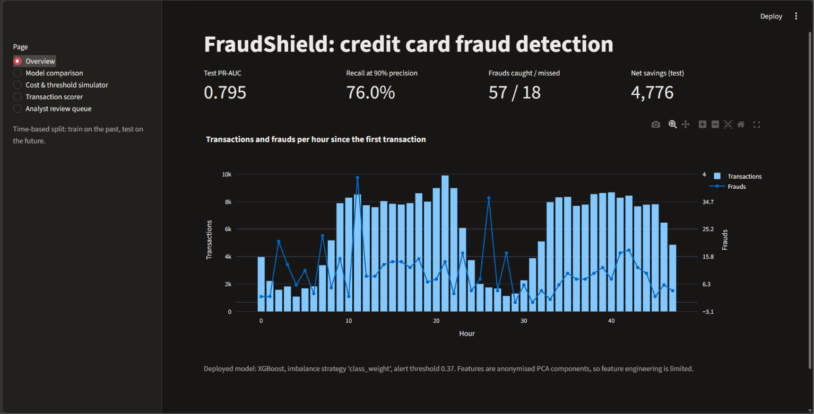

# 🛡️ FraudShield: Credit Card Fraud Detection System

A machine learning system that detects fraudulent credit card transactions, built and evaluated the way production fraud systems work: trained on the past, tested on the future, with the alert threshold chosen from money, not from a default 0.5. It includes model training and comparison, probability calibration, SHAP explainability, and a live Streamlit dashboard.

🔗 **Live demo:** https://fraudshield-creditcard.streamlit.app/


---

## 🚀 Overview

Fraud detection is a highly imbalanced classification problem: fraudulent transactions are only about 0.17% of all activity. Accuracy is meaningless here (a model that always says "legitimate" scores about 99.8%), so this project uses PR-AUC, recall at fixed precision, and a cost-based decision threshold.

---

## 📊 Dataset

- **Source:** Kaggle *Credit Card Fraud Detection* (ULB Machine Learning Group)
- Download `creditcard.csv` from Kaggle and place it inside the `data/` folder
- **Total records:** 284,807
- **Fraud cases:** 492 (~0.17%)
- **Features:**
  - `V1`–`V28`: PCA-transformed, anonymised features
  - `Time` (seconds since the first transaction, about two days) and `Amount`
  - Target: `Class` (0 = legitimate, 1 = fraud)

---

## 🧱 Project Structure

```
FraudShield/
├── app/
│   └── dashboard.py            # Streamlit dashboard
├── src/
│   ├── data.py                 # loading, features, time-based split
│   ├── metrics.py              # PR-AUC, recall at precision, cost/threshold table
│   ├── calibration.py          # Platt scaling
│   └── train.py                # training, comparison, calibration, artefacts
├── tests/
│   └── test_pipeline.py        # split, features and threshold tests
├── models/                     # saved XGBoost model, calibrator, config
├── reports/                    # metrics, PR curves, threshold table, SHAP importance
├── explore.py                  # first look at the data
├── requirements.txt
└── README.md
```

---

## 🔍 Exploratory Data Analysis

- Extremely imbalanced: 492 frauds in 284,807 transactions (~0.17%)
- `Amount` is heavily skewed, so a log transform (`log_amount`) is used
- Tree-based models outperformed logistic regression (PR-AUC 0.79 to 0.82 vs 0.75), suggesting non-linear structure helps
- `V1`–`V28` are anonymised PCA components, so feature engineering is limited

---

## 🧪 Evaluation Design

What is different from a typical Kaggle fraud notebook:

- **Time-based split:** the oldest 60% of transactions train the model, the next 20% are used for validation, and the newest 20% form the test set. No random shuffling, so the model never sees the future
- **SMOTE only inside a pipeline:** no resampling, class weights and SMOTE were compared on the validation set, and the best strategy was used for the deployed model
- **PR-AUC and recall at 90% precision** instead of accuracy
- **Probability calibration** (Platt scaling fitted on validation data)
- **Cost-based threshold:** chosen on validation to maximise net savings (fraud value caught minus review cost), then applied once to the untouched test set

---

## 🤖 Models Implemented

| Model | Type |
|---|---|
| Logistic regression | Supervised baseline |
| Random forest | Supervised |
| **XGBoost (deployed)** | Supervised |
| Isolation Forest | Unsupervised anomaly detection (never sees labels) |

---

## ⚖️ Model Comparison (time-based test set: 56,962 transactions, 75 frauds)

| Model | PR-AUC | Recall at 90% precision |
|---|---|---|
| Logistic regression | 0.7484 | 69.33% |
| Random forest | 0.8207 | 76.00% |
| **XGBoost (deployed)** | **0.7947** | **76.00%** |
| Isolation Forest (unsupervised) | 0.0460 | 0.00% |

### Key insights

- Supervised models far outperform the unsupervised Isolation Forest, because labelled fraud data is available.
- Random forest scored a higher PR-AUC (0.821 vs 0.795) and tied on recall at 90% precision. XGBoost is deployed because it supports fast SHAP explanations and low-latency scoring. With only 75 test frauds, the PR-AUC gap may be within noise (not tested).

---

## 💰 Business Impact at the Chosen Threshold

Review cost is assumed to be 5 currency units per alert.

| Metric | Value |
|---|---|
| Alerts raised | 63 |
| Frauds caught | 57 of 75 |
| Frauds missed | 18 |
| Precision at threshold | 90.5% (57 / 63) |
| Recall at threshold | 76.0% (57 / 75) |
| Net savings (test period) | 4,776 currency units |

---

## 🔍 Model Explainability (SHAP)

SHAP (SHapley Additive exPlanations) explains each prediction by showing how much every feature pushed the fraud score up or down. This improves transparency, trust in alerts, and debugging. The dashboard shows a SHAP waterfall for